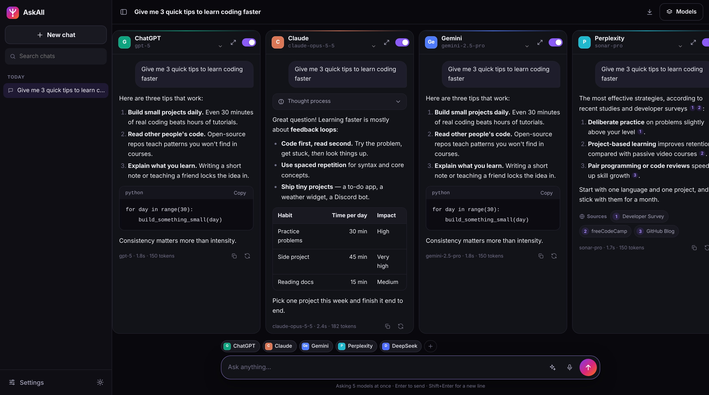

<div align="center">


# AskAll

**Ask once. Compare every AI.**

Ask one question and get answers from ChatGPT, Gemini, Claude, Grok, DeepSeek, Perplexity, Llama and your own offline models, streamed side by side so you can compare them instantly.

[](https://render.com/deploy?repo=https://github.com/kryptonite012/AI-chatbot)
[](https://vercel.com/new/clone?repository-url=https%3A%2F%2Fgithub.com%2Fkryptonite012%2FAI-chatbot)



</div>

---

## About

I got tired of copy-pasting the same question into five different AI apps, so I made one place that asks all of them at once. You bring your own API keys (a few are free) and every model answers in its own column.

## Features

- One prompt goes to every model you turn on, answers stream in at the same time
- ChatGPT, Gemini, Claude, Grok, DeepSeek, Perplexity, Groq (Llama etc.), OpenRouter and Ollama for offline use
- Any OpenAI-compatible server (LM Studio, vLLM, LocalAI) can be added too
- Pick the model for each column, or load the full model list from the provider
- Turn models on/off, or expand one column to keep chatting with just that model
- ✨ button to improve your prompt before sending
- Voice input (Chrome / Edge)
- Shows the "thinking" for models that return it, and sources for Perplexity
- Markdown, tables and code blocks with a copy button
- Chat history with search, rename, delete, export to Markdown, backup/restore
- Dark / light theme, works on mobile
- Chats are saved in your browser only, optional password for the whole site
- No dependencies, no build step, just Node

## Quick start (2 minutes)

You need **[Node.js 20 or newer](https://nodejs.org)**.

```bash
git clone https://github.com/kryptonite012/AI-chatbot.git
cd AI-chatbot
cp .env.example .env     # then paste the API keys you have into .env
npm start
```

Open **http://localhost:3000**. That's it.

> On Windows you can simply double-click **`start.bat`** (or run `./start.sh` on macOS/Linux). It creates `.env` for you and starts the app.

Don't want to edit files? Leave `.env` empty, open the app and paste keys in **Settings → API keys**. They are saved only in your browser.

## Get API keys

You only need **one** to start. Every provider you add becomes another column.

| Provider | Free option | Get a key |
| --- | --- | --- |
| Gemini (Google) | ✅ Generous free tier | https://aistudio.google.com/apikey |
| Groq (Llama, GPT-OSS…) | ✅ Free tier | https://console.groq.com/keys |
| OpenRouter (300+ models) | ✅ Free models (`:free`) | https://openrouter.ai/keys |
| Ollama (offline) | ✅ Free, runs locally | https://ollama.com/download |
| ChatGPT (OpenAI) | Pay as you go | https://platform.openai.com/api-keys |
| Claude (Anthropic) | Pay as you go | https://console.anthropic.com/settings/keys |
| Grok (xAI) | Pay as you go | https://console.x.ai |
| DeepSeek | Very cheap | https://platform.deepseek.com/api_keys |
| Perplexity | Pay as you go | https://www.perplexity.ai/account/api/keys |

## Offline mode (no internet, no keys)

1. Install [Ollama](https://ollama.com/download).
2. Download a model: `ollama pull llama3.2` (or `qwen3`, `gemma3`, `mistral`, `deepseek-r1`…).
3. Start the app with `npm start`. The **Local AI** column switches on automatically and lists every model you have installed.

Everything (the app, the model and your chats) now runs on your own computer. Pull more models and pick them from the column's model menu.

> Tip: LM Studio, vLLM, LocalAI and other OpenAI-compatible servers work too. Set `CUSTOM_BASE_URL` (for LM Studio: `http://localhost:1234/v1`) and optionally `CUSTOM_NAME`.

## Deploy

Before you deploy publicly, **set `APP_PASSWORD`** so strangers can't use your API keys.

### Render (free)
Click **Deploy to Render** at the top of this page, then fill in the keys you have. Render reads `render.yaml` automatically.

### Vercel
Click **Deploy with Vercel**, then add your keys under *Project → Settings → Environment Variables* and redeploy. Answers can stream for up to 60 seconds per request by default. You can raise `maxDuration` in `vercel.json` if your plan allows it.

### Railway / Fly.io / Heroku / any Node host
Create a new project from this GitHub repo. The start command is `npm start` (a `Procfile` is included). Add your keys as environment variables.

### Docker

```bash
docker compose up -d                     # cloud models only
docker compose --profile offline up -d   # plus a bundled Ollama for offline models
docker compose exec ollama ollama pull llama3.2
```

Or with plain Docker:

```bash
docker build -t askall .
docker run -p 3000:3000 --env-file .env askall
```

### Your own server (VPS)

```bash
git clone https://github.com/kryptonite012/AI-chatbot.git && cd AI-chatbot
cp .env.example .env && nano .env
PORT=3000 npm start          # run it behind nginx/Caddy for HTTPS, or use pm2 / systemd
```

## Configuration

All settings are environment variables (or lines in `.env`). Everything is optional.

| Variable | Default | What it does |
| --- | --- | --- |
| `APP_NAME` | `AskAll` | Name shown in the app and browser tab |
| `APP_TAGLINE` | `Ask once. Compare every AI.` | Short tagline |
| `PORT` / `HOST` | `3000` / `0.0.0.0` | Where the server listens |
| `APP_PASSWORD` | – | Require a password to use the app |
| `ALLOW_CLIENT_KEYS` | `true` | Let users paste their own keys in Settings |
| `RATE_LIMIT_PER_MINUTE` | `60` | Chat requests per visitor per minute (`0` = off) |
| `REQUEST_TIMEOUT_MS` | `300000` | Max time for one answer |
| `OPENAI_API_KEY`, `GEMINI_API_KEY`, `ANTHROPIC_API_KEY`, `XAI_API_KEY`, `DEEPSEEK_API_KEY`, `PERPLEXITY_API_KEY`, `GROQ_API_KEY`, `OPENROUTER_API_KEY` | – | Provider keys |
| `OLLAMA_BASE_URL` | `http://localhost:11434` | Where Ollama runs |
| `CUSTOM_BASE_URL`, `CUSTOM_NAME`, `CUSTOM_API_KEY`, `CUSTOM_MODELS` | – | Add any OpenAI-compatible endpoint as a column |
| `<PROVIDER>_MODELS` | built-in list | Comma-separated model list for a provider, first is default (e.g. `OPENAI_MODELS=gpt-5,gpt-5-mini`) |
| `<PROVIDER>_BASE_URL` | official API | Send a provider through a proxy or gateway |
| `<PROVIDER>_ENABLED` | `true` | Set to `false` to hide a provider |

`<PROVIDER>` is one of `OPENAI`, `GEMINI`, `ANTHROPIC`, `XAI`, `DEEPSEEK`, `PERPLEXITY`, `GROQ`, `OPENROUTER`, `OLLAMA`.

**Rebranding:** set `APP_NAME`, replace `public/logo.svg` and `public/favicon.svg`, and update the name in `public/manifest.webmanifest`.

## How it works

```
Browser (public/)                         Server (server.js + lib/)                AI providers
┌──────────────────────────┐   POST     ┌────────────────────────────┐  HTTPS   ┌──────────────┐
│ One prompt → N columns   │ /api/chat  │ Adds the API key, calls    │ ───────▶ │ OpenAI       │
│ Streams each answer live │ ─────────▶ │ the provider, converts its │          │ Google       │
│ Chats saved in browser   │ ◀───────── │ stream into one simple     │ ◀─────── │ Anthropic    │
│                          │  SSE       │ format                     │          │ Ollama (local)│
└──────────────────────────┘            └────────────────────────────┘          └──────────────┘
```

Each column sends its own request, so a slow or failing model never blocks the others. Every model receives its own conversation history, so follow-up questions work naturally.

```
├── server.js            # starts the web server
├── lib/
│   ├── app.js           # static files + security headers
│   ├── handler.js       # /api routes: config, models, chat (also used by Vercel)
│   ├── providers.js     # provider list + streaming adapters
│   └── env.js           # .env loader
├── api/index.js         # Vercel serverless entry
├── public/              # the web app (HTML, CSS, vanilla JS)
└── test/                # automated tests (npm test)
```

## Privacy & security

- Chats, settings and keys you paste in the app are stored **only in your browser** (localStorage).
- Keys set on the server are never sent to the browser.
- Model output is fully escaped before it is shown, and a strict Content-Security-Policy is applied.
- Use `APP_PASSWORD` for public deployments, and `ALLOW_CLIENT_KEYS=false` if only your server keys should be used.

## Development

```bash
npm run dev    # auto-restarts on changes
npm test       # runs the test suite (no API keys needed)
```

## License

[MIT](LICENSE) © kryptonite012
